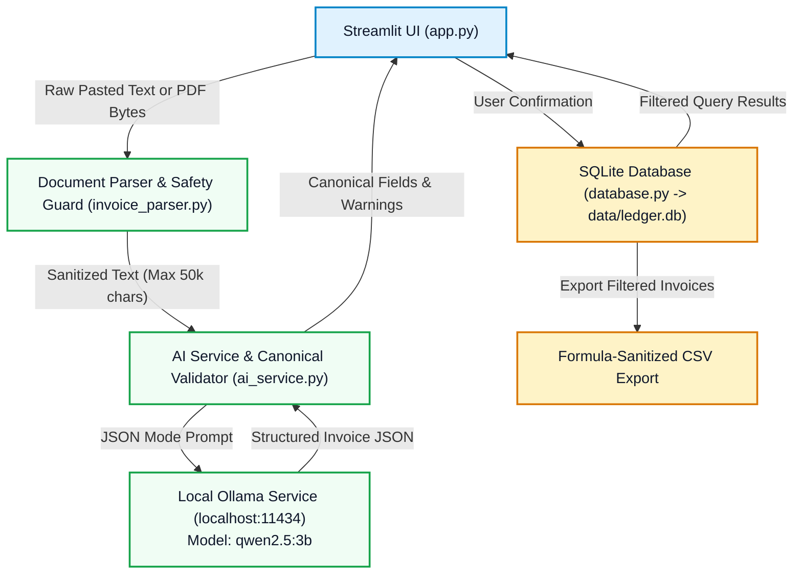

# LocalLedger AI

[](https://www.python.org/)
[](https://streamlit.io/)
[](https://ollama.com/)
[](https://sqlite.org/)
[](https://drive.google.com/file/d/1uTFPEZ8HfIOu0nSthFHvDq4_QKxQ2hwa/view?usp=drivesdk)
[](LICENSE)
[](TESTING.md)

> 🎥 **Live Demo Video:** [Watch the LocalLedger AI Walkthrough on Google Drive](https://drive.google.com/file/d/1uTFPEZ8HfIOu0nSthFHvDq4_QKxQ2hwa/view?usp=drivesdk)

**LocalLedger AI** is a privacy-first, on-device invoice and receipt organizer designed for freelancers, independent contractors, and small business owners. It extracts structured financial records from unstructured invoice text and text-based PDFs using an open-weight language model running locally on your computer.

All document parsing, AI inference, and SQLite storage occur entirely on `localhost`. No financial documents or client details are sent to third-party cloud APIs.

---

## 1. Problem Statement & Objective

Freelancers and micro-business operators face significant friction managing business expenses:
- **Cloud Privacy Risks:** Uploading confidential financial documents, client names, hourly rates, and home addresses to public cloud AI tools compromises data sovereignty.
- **Subscription & Token Overhead:** Commercial SaaS receipt scanners charge recurring monthly tiers or per-page API fees, penalizing freelancers for routine bookkeeping.
- **Manual Data Entry Burden:** Manually transcribing dates, invoice numbers, tax breakdowns, and totals into spreadsheets is slow and error-prone.

**Objective:** Deliver a zero-cloud, reliable, and cost-free desktop organizer that combines on-device open-weight AI (`qwen2.5:3b`) with human-in-the-loop review, duplicate prevention, and spreadsheet-safe CSV exports.

---

## 2. Key Features

- **Document Ingestion:** Paste invoice text directly or upload text-based `.pdf` / `.txt` files (enforces a safe 5 MB limit).
- **On-Device LLM Extraction:** Uses local Ollama (`qwen2.5:3b`) in JSON mode to extract 8 canonical fields: `vendor`, `invoice_number`, `invoice_date`, `subtotal`, `tax`, `total`, `currency`, and `category`.
- **Anti-Hallucination Safeguards:** Missing or uncertain values strictly evaluate to `null`, never fabricated.
- **Human-in-the-Loop Review:** Extracted fields are displayed in an editable review form prior to persistence.
- **Arithmetic Discrepancy Detection:** Alerts the user when `subtotal + tax != total` or when negative credit notes occur, without silently modifying data.
- **Duplicate Prevention:** Matches incoming records against existing entries by `(vendor, invoice_number)` or `(vendor, date, total)`, requiring explicit confirmation before saving.
- **Financial Dashboard:** Real-time metrics for confirmed invoice counts, primary spend, category breakdown tables, and separate multi-currency tracking.
- **Searchable Ledger & CSV Export:** Search by vendor or invoice number, filter by category and date ranges, and export spreadsheet-safe CSVs protected against formula injection (`=`, `@`, `+`, `-`).

---

## 3. Technology Stack

- **Application Language:** Python 3.11.9
- **User Interface:** Streamlit (clean financial theme)
- **Local AI Engine:** [Ollama](https://ollama.com/) running on `http://127.0.0.1:11434`
- **Default Model:** `qwen2.5:3b` (3.1B parameter open-weight model, 4-bit quantized)
- **PDF Extraction:** `pypdf` (in-memory processing)
- **Local Storage:** SQLite (Python standard library `sqlite3` -> `data/ledger.db`)
- **Export Formats:** CSV (Python standard library `csv` with formula sanitization)

---

## 4. System Architecture & Workflow



*For complete architectural specifications, see [docs/ARCHITECTURE.md](docs/ARCHITECTURE.md).*

---

## 5. Project Directory Structure

```text
localledger_ai/
├── app.py                      # Streamlit user interface & navigation
├── ai_service.py               # Local Ollama client & canonical schema validation
├── invoice_parser.py           # Safe text/PDF extraction & pipeline coordinator
├── database.py                 # SQLite storage, search, aggregations & CSV export
├── compare_models.py           # Standalone benchmark (Local Ollama vs. optional Gemini)
├── requirements.txt            # Core dependencies (streamlit, pypdf, requests)
├── requirements-gemini.txt     # Optional benchmark dependency (google-genai)
├── .env.example                # Safe environment variable configuration template
├── .gitignore                  # Excludes databases, credentials, venvs, and private docs
├── README.md                   # Project overview & documentation
├── TESTING.md                  # Automated test documentation & results (36 passing)
├── DEMO_GUIDE.md               # 60–90 second demonstration script & test samples
├── SECURITY.md                 # Security policy, formula injection defense & privacy
├── CUSTOMER_PILOT.md           # User interview framework & pilot testing guide
├── PILOT_RESULTS_TEMPLATE.md   # Unpopulated feedback collection template
├── SUBMISSION_DRAFT.md         # Side Hustle challenge submission text
├── docs/
│   ├── ARCHITECTURE.md         # Comprehensive architecture & sequence diagrams
│   └── architecture.mmd        # Editable Mermaid architecture source
└── tests/                      # Automated unittest test suite (36 tests)
    ├── __init__.py
    ├── test_invoice_parser.py
    ├── test_database.py
    ├── test_ai_service.py
    ├── test_csv_export.py
    ├── test_benchmark_safety.py
    └── test_reliability_edge_cases.py
```

---

## 6. Windows Setup & Installation Guide

### Prerequisites
1. **Python 3.10+** (Python 3.11 recommended).
2. **Ollama for Windows**: Download from [ollama.com/download/windows](https://ollama.com/download/windows) or install via PowerShell:
   ```powershell
   winget install Ollama.Ollama
   ```

### Step-by-Step Setup

1. **Clone or Open the Repository:**
   ```powershell
   git clone https://github.com/snappyff43-hub/Ledger-AI.git
   cd Ledger-AI
   ```

2. **Create and Activate a Local Virtual Environment:**
   ```powershell
   python -m venv .venv
   .\.venv\Scripts\Activate.ps1
   ```

3. **Install Dependencies:**
   ```powershell
   .\.venv\Scripts\pip.exe install -r requirements.txt
   ```

4. **Pull and Start the Local Model:**
   In any PowerShell terminal, run:
   ```powershell
   ollama run qwen2.5:3b
   ```
   *(Once the model prompt loads, type `/bye` to exit the prompt; Ollama will remain running in the background).*

5. **Launch the Streamlit Application:**
   ```powershell
   .\.venv\Scripts\streamlit.exe run app.py
   ```
   Open your browser to: **`http://localhost:8501`**

---

## 7. Automated Testing & Verification Results

LocalLedger AI includes a 36-test automated regression suite built on Python's native `unittest` framework. All tests use synthetic data and isolated temporary SQLite databases, executing 100% offline without modifying user data.

To run the automated test suite:
```powershell
$env:PYTHONPATH="E:\Hacktoberweek2\localledger_ai"
.\.venv\Scripts\python.exe -m unittest discover -s tests -p "test_*.py" -v
```

**Latest Actual Test Results:**
- **Tests Discovered:** 36
- **Tests Passed:** 36
- **Failures / Errors:** 0
- **Execution Time:** ~4.5 seconds
- **Status:** `OK` (100% Passing)

*See [TESTING.md](TESTING.md) for full module breakdowns.*

---

## 8. Optional Cloud Benchmark (`compare_models.py`)

A separate, standalone benchmark script is provided to evaluate on-device Ollama against Google Gemini on a fixed synthetic test invoice (`ACME CLOUD SOLUTIONS LLC`).

- **Decoupled:** The core application does **not** depend on or call Gemini.
- **Safe Skip:** If `GEMINI_API_KEY` is not set, the benchmark evaluates Ollama and safely skips Gemini without crashing.
- **Usage:**
  ```powershell
  # Optional: install benchmark SDK
  .\.venv\Scripts\pip.exe install -r requirements-gemini.txt

  # Set key securely in PowerShell
  $env:GEMINI_API_KEY="your_api_key_here"

  # Run comparison
  .\.venv\Scripts\python.exe compare_models.py
  ```

*See [MODEL_COMPARISON.md](MODEL_COMPARISON.md) for benchmark documentation and trade-off analysis.*

---

## 9. Security, Privacy & Known Limitations

- **Zero Cloud Leakage:** Invoices are parsed locally; real invoice text and binary PDF streams are never written to disk or sent across networks.
- **Formula Injection Protection:** All exported CSV cells are sanitized against spreadsheet command injection (`=, +, -, @`).
- **Scanned PDF Limitation:** Documents without a text layer require manual text pasting, as local OCR (Tesseract) is omitted to keep dependencies minimal.
- **CPU Inference Latency:** On laptops lacking dedicated GPUs, local CPU inference with `qwen2.5:3b` requires ~25–35 seconds per invoice.

---

## 10. Demonstration Guide

To present LocalLedger AI in 60–90 seconds using synthetic test data, follow the live script and sample receipts in [DEMO_GUIDE.md](DEMO_GUIDE.md).

---

## License

This project is licensed under the [MIT License](LICENSE).
