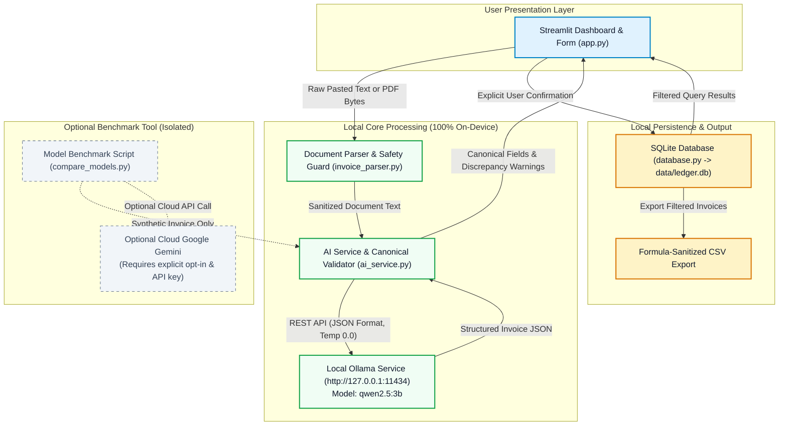
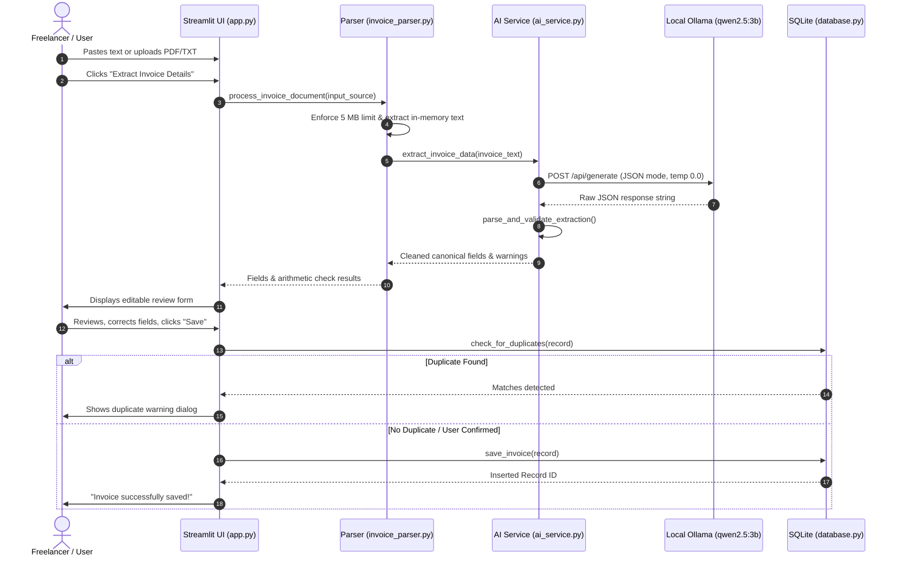

# LocalLedger AI — System Architecture & Workflow

This document details the architectural layout, core subsystems, data pipelines, and security boundaries implemented in **LocalLedger AI**.

---

## 1. High-Level Architecture Diagram

---

## 2. Core Subsystems

### A. Presentation Layer (`app.py`)
- **Technology:** Streamlit.
- **Role:** Interactive dashboard, document ingestion forms, review and confirmation views, and tabular history exploration.
- **Human-in-the-Loop:** Displays AI-extracted fields in editable inputs. Requires the user to explicitly click **Save Confirmed Invoice** before committing data to disk.
- **Duplicate Interception:** If a record matches an existing invoice by `(vendor, invoice_number)` or `(vendor, date, total)`, displays an explicit warning modal requiring checkbox confirmation to prevent accidental re-saving.

### B. Document Parser & Pipeline Coordinator (`invoice_parser.py`)
- **Technology:** `pypdf` & Python standard library.
- **Safety Boundaries:** Enforces a 5 MB maximum file size and a 50,000 character length cap.
- **In-Memory Operation:** Uploaded PDF and TXT documents are parsed strictly in memory and are never saved to disk.
- **Scanned Document Detection:** Flags PDFs with 0 extractable text characters as scanned images, guiding the user to paste text manually rather than silently failing.

### C. AI Inference & Canonical Validator (`ai_service.py`)
- **Technology:** Local Ollama REST API (`/api/generate` with `format: "json"`).
- **Default Model:** `qwen2.5:3b` (3.1B parameter open-weight model).
- **Anti-Hallucination Design:** Prompt instructions strictly forbid guessing missing values. Missing fields evaluate to `null` / `None`.
- **Validation Engine:** Normalizes dates into ISO `YYYY-MM-DD`, accepts legitimate `0.0` values, flags negative credit notes, and detects arithmetic discrepancies (`subtotal + tax != total`) without mutating original values.

### D. Persistence & CSV Exporter (`database.py`)
- **Technology:** Python built-in `sqlite3`.
- **Database Path:** `data/ledger.db` (auto-created and indexed on startup).
- **Data Privacy:** Raw document text and PDF binary streams are never persisted. Only confirmed canonical fields, source filenames, and ISO timestamps are stored.
- **CSV Formula Injection Mitigation:** All untrusted text fields exported to CSV are checked; leading formula triggers (`=`, `+`, `-`, `@`, `\t`, `\r`) are automatically escaped with a leading apostrophe.

### E. Optional Benchmark Tool (`compare_models.py`)
- **Completely Decoupled:** Exists solely for developer benchmarking on fixed synthetic data (`ACME CLOUD SOLUTIONS LLC`).
- **Safe Skip Logic:** If `GEMINI_API_KEY` is not present, the script executes Ollama and skips Gemini without crashing or exposing secrets.

---

## 3. Invoice Processing Workflow

